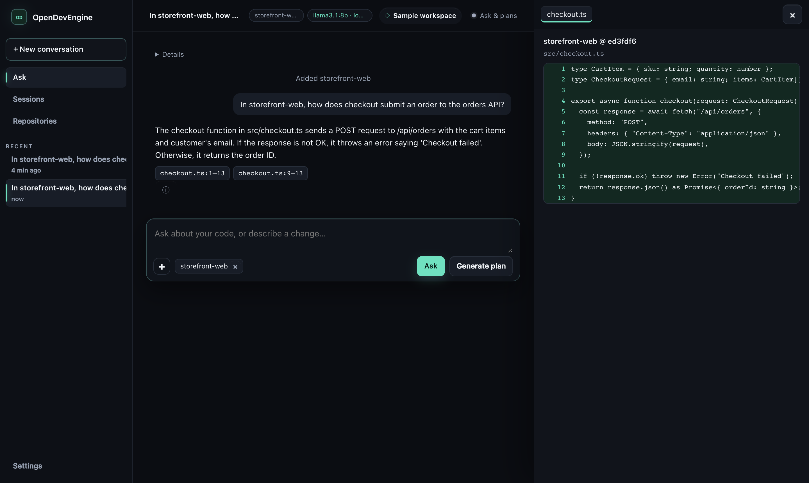

# OpenDevEngine

OpenDevEngine is a self-hosted workspace that takes you from *"where does this feature live?"*
to a reviewed draft pull request. Connect GitHub once, ask about your code across all
your repositories, save an implementation plan, and follow a sandboxed coding-agent
session until it opens a draft PR for you to review.

It runs on your own computer, keeps credentials in your operating system's vault, and
keeps your source on your machine unless you explicitly opt a model in.



> **Status: early release (0.1).** The connect → ask → plan → session → draft PR flow
> works end to end with GitHub, Ollama or OpenAI-compatible models, Docker and the
> Claude Code CLI. Reusable skills, plugins and memory are planned and not built yet.
> See [CHANGELOG.md](CHANGELOG.md) and the [roadmap](#roadmap).

## What it does

- **Ask across repositories.** Describe a feature in plain language; OpenDevEngine finds
  the likely repositories, explains why, and answers with citations to exact files and
  lines in an indexed commit.
- **Plan before changing code.** Turn a conversation into a structured, versioned
  implementation plan you can edit. Ask never runs code or edits files.
- **Supervised sessions.** Start a session from a saved plan. The coding agent edits files
  and runs commands only through OpenDevEngine, inside an isolated container with no network;
  you watch progress, the diff and checks, can send guidance, and can stop it at any time.
- **Draft pull requests only.** Review the diff and checks, then publish a draft PR to a
  new `opendevengine/…` branch. Nothing is merged or pushed to a default branch.
- **Bring your own models.** Ollama, any OpenAI-compatible endpoint, or the Claude Code
  CLI for answers, plans and summaries; an embedding model (for example from Ollama) for
  smarter code search.

## Quick start

Requirements: Python 3.10+ with SQLite FTS5 (python.org and Homebrew builds include it)
and Git.

```sh
git clone https://github.com/opendevengine/opendevengine.git opendevengine
cd opendevengine
python3 -m venv .venv
source .venv/bin/activate
python -m pip install -e '.[full]'
opendevengine --data-dir ~/.local/share/opendevengine
```

Open <http://127.0.0.1:8765>.

- Without `--data-dir`, OpenDevEngine runs an in-memory demo with four bundled sample
  repositories (a storefront, an orders API, a database migration and a notification
  worker). Nothing is saved.
- With `--data-dir`, conversations, plans, sessions and settings persist across restarts.
  GitHub and credentialed model setup need persistent storage.
- Without the optional packages, `python3 -m opendevengine` still runs the demo. (The Python
  package keeps its original `opendevengine` name.)

Already running Ollama with a downloaded model? Use it for answers and plans right away:

```sh
opendevengine --model llama3.1:8b --data-dir ~/.local/share/opendevengine
```

## Connect GitHub

Settings → GitHub → **Connect GitHub**. OpenDevEngine creates a private GitHub App on your
account from a manifest (Contents and Pull requests: read and write; Metadata: read).
You review it on GitHub and click Create; the App ID and private key go straight into
your OS credential vault. Then install the App on the repositories you want.

To reuse an App you already have, choose **Use an existing GitHub App** and enter its
App ID, slug and private key. Its Setup URL must be
`http://127.0.0.1:8765/api/github/callback` for the default port. OpenDevEngine does not
import your GitHub CLI login.

On the Repositories page, two switches are independent per repository:

- **Use in Ask**: index it and include it in answers and plans.
- **Allow changes**: let sessions open draft pull requests against it.

## AI providers

Settings → AI providers. Add the providers you use:

- **Claude**: an Anthropic API key, or your `claude` CLI login (Pro or Max).
- **Codex (OpenAI)**: an OpenAI API key; the API URL is editable.
- **Local models**: an Ollama or OpenAI-compatible server (LM Studio, vLLM, llama.cpp) by URL,
  on this computer or another machine you own. A Local URL is treated as your own machine:
  code is sent there without asking.

Adding Claude or Codex asks once for permission to send parts of your code to Anthropic or
OpenAI, and turns off **Keep everything on this computer**. Turning that back on in Settings →
Privacy blocks those providers again.

Then choose what each job uses: **Plans & answers**, **Coding** and, optionally, **Code search**
(an embedding model on a Local Ollama server). Repository summaries follow Plans & answers
unless you change them under **More jobs**. Coding uses Claude for now; Codex for coding is
planned. Connection tests send synthetic content only. Older model profiles and the coding
agent's own settings remain under **Advanced**.

## Implementation sessions and draft pull requests

Finished sessions offer **Delete session content**; local content is purged while minimal identity and GitHub PRs remain.

Requirements: Docker running, the `python:3.12-slim` image already pulled (sessions never
pull images and have no network: `docker pull python:3.12-slim`), and the
[Claude Code](https://docs.claude.com/en/docs/claude-code) CLI installed. Start OpenDevEngine
with `--data-dir`.

1. **Settings → AI providers:** add **Claude** (API key or your `claude` login) and choose it
   for **Coding**. OpenDevEngine sets up the coding environment and runs a short test coding
   task; wait for **✓ tested**. To sign pull request commits with your name, set the
   **Pull request author** under **Advanced**.
2. *(Optional)* Choose a different provider for **Plans & answers**, for example a Local model.
3. **Repositories:** turn on **Use in Ask** and **Allow changes** for the target repository.
4. **Ask:** describe the change with the repository attached and click **Generate plan**.
   New plans use the coding provider you chose and are ready to start; click **Start session**
   on the plan card.
5. **Session:** follow progress, the diff and checks. Validation runs inside the container.
   **Stop session** cancels it and confirms the container is gone.
6. **PR tab → Create draft PR:** review repository, branches, changed paths and checks, edit
   the title and description, then **Publish draft PR**. Newly generated files (such as
   `__pycache__/`) are left out and listed in the description; other rejected paths block
   publication.

**Recovery.** If OpenDevEngine stops while a session runs, the next start confirms the
container and agent are gone and marks the session **interrupted** (edits after the last
checkpoint may be lost); use **Retry as a new attempt**. A publication whose GitHub
response was lost is reconciled against GitHub on the next start or on **Retry**, and
never creates a second branch or pull request.

## Using local checkouts instead of GitHub

The demo can index explicit local Git checkouts (committed `HEAD`, up to eight):

```sh
opendevengine --repo web=/path/to/storefront --repo api=/path/to/orders-api
```

## Troubleshooting

- **Answers or plans time out with a local model.** Local models are only as fast as the
  hardware running them. On a laptop without GPU acceleration an 8B model can take several
  minutes per answer, and plan generation (longer structured output) can exceed the profile's
  time limit (10 minutes for the profile `--model` creates; adjustable per profile in Settings →
  Models). Use a smaller model (for example a 3B model) or a machine with a GPU, or
  assign a hosted OpenAI-compatible provider after turning off local-only mode.
  `ollama ps` shows whether a model is running on the CPU or the GPU.
- **"Choose a repository to continue."** Ask only searches repositories it can identify.
  Name the repository in the question, attach it with **+**, or pick one of the suggested
  repositories; each suggestion shows the terms that matched.
- **GitHub setup is unavailable.** Credentials need persistent storage and an unlocked OS
  credential vault: start with `--data-dir` and unlock your keychain.
- **A session fails before the agent starts.** Check that Docker is running,
  `python:3.12-slim` is pulled locally, and Coding shows **✓ tested** in Settings → AI providers.

## Security and privacy

- Binds to `127.0.0.1` for a single user, with host and origin checks. It has no login
  and must not be exposed on a network.
- Credentials live only in macOS Keychain, Linux Secret Service or Windows Credential
  Manager. If secure storage is missing or locked, credential setup is blocked; there is
  no plaintext fallback.
- Indexing never runs repository scripts and skips credential-like and generated files.
- In a session, repository files and commands live in a container with no network, dropped
  capabilities, a read-only root filesystem and resource limits. The Claude Code CLI itself
  runs on your computer with its built-in tools, hooks, plugins and settings disabled; it can
  act only through OpenDevEngine's tools into that container, and it talks to Anthropic using
  your own login.

See [SECURITY.md](SECURITY.md) for the full model and how to report a vulnerability.

## Roadmap

| Milestone | Scope | Status |
| --- | --- | --- |
| M0 | Durable local storage, jobs, secrets, navigation | Done |
| M1 | GitHub discovery, hybrid indexing, routing, providers, Ask and versioned plans | Done |
| M2 | Container sessions, Claude Code adapter, diffs and checks, draft PRs, recovery | Done |
| M3 | User skills, approved plugins/MCP tools, scoped memory | Planned |
| M4 | More coding-agent adapters (Codex CLI first), richer cross-repository execution | Planned |

## Development

```sh
python -m unittest discover -s tests
OPENDEVENGINE_TEST_PYTHON="$(command -v python)" node --test tests/ui/*.test.mjs
```

Real Docker checks are opt-in (`OPENDEVENGINE_DOCKER_TESTS=1`, `OPENDEVENGINE_SESSION_DOCKER=1`).
Vector tests need the `vectors` extra. See [CONTRIBUTING.md](CONTRIBUTING.md) for
setup and conventions.

## License

[MIT](LICENSE). Third-party packages installed by the optional extras are listed in
[THIRD_PARTY_NOTICES.md](THIRD_PARTY_NOTICES.md).
